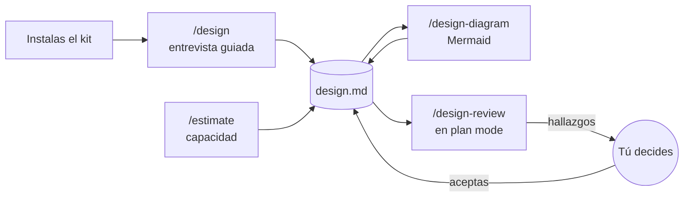
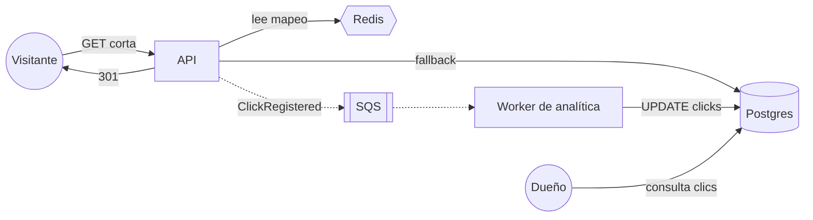

<div align="center">

# System Design Kit

**Diseña sistemas con Claude Code, pregunta por pregunta.**

Un documento de diseño completo —requisitos, escala, API, arquitectura, decisiones y fallas—
construido en conversación, con diagramas y revisiones críticas incluidos.

[](https://github.com/lacasoft/system-design-kit/actions/workflows/ci.yml)


</div>

---

## Qué es

Un **kit para Claude Code** que convierte cualquier carpeta en un taller de System Design. Lo
instalas con un comando y obtienes:

- un documento **`design.md`** con la estructura de un design doc profesional;
- un **entrevistador** que te hace las preguntas correctas, una a la vez, y escribe tus respuestas;
- **estimaciones de capacidad** con la aritmética a la vista;
- **diagramas Mermaid** generados a partir de lo que escribiste;
- un **revisor crítico** que, en plan mode, busca cómo puede fallar tu diseño sin tocarlo.

**El diseño es tuyo.** Claude pregunta, registra, calcula y critica; no propone la arquitectura
salvo que se lo pidas.

### Para qué sirve

| Caso | Cómo ayuda |
|---|---|
| **Diseñar antes de construir** | Llegas al código con requisitos cuantificados, decisiones justificadas y fallas previstas. |
| **Preparar entrevistas de system design** | Practicas el método completo con alguien que te repregunta y te señala lo que olvidaste. |
| **Revisar un diseño existente** | Pasas el diseño a `design.md` y pides revisiones acotadas por flujo o por componente. |

**Qué no es:** no genera código ni una arquitectura "de plantilla". Si no sabes un dato, el kit
propone un supuesto marcado como tal; nunca lo da por hecho.

---

## Cómo funciona



1. **Construyes el documento.** `/design` recorre las secciones en orden y te pregunta lo que un
   entrevistador senior preguntaría. Cada respuesta queda escrita en `design.md`.
2. **Cuantificas.** `/estimate` convierte usuarios y patrones de uso en QPS, almacenamiento y ancho
   de banda, mostrando cada cálculo.
3. **Dibujas.** `/design-diagram` genera los diagramas desde el texto y verifica que digan lo mismo.
4. **Revisas.** Con requisitos, escala y arquitectura listos, abres Claude Code en **plan mode** y
   pides una revisión acotada: hasta tres escenarios de falla, cada uno con la mitigación más
   pequeña y su costo.
5. **Iteras.** Lo que aceptas vuelve al documento; lo que cambia se tacha, no se borra.

---

## Inicio rápido

**Requisitos:** [Claude Code](https://code.claude.com) y Node.js 18 o superior.

```bash
mkdir acortador-urls && cd acortador-urls
npx -y github:lacasoft/system-design-kit#v1.0.0
```

El instalador pregunta el idioma del documento (español o inglés) y qué vas a diseñar. Para
instalar sin preguntas:

```bash
npx -y github:lacasoft/system-design-kit#v1.0.0 --lang en --title "URL shortener" --yes
```

Después:

```bash
claude          # la primera vez acepta el diálogo de confianza de la carpeta
> /design
```

---

## Así se ve en la práctica

Salidas reales de una sesión de prueba (recortadas), diseñando un acortador de URLs.

### La entrevista

```text
> /design

Estamos en Fuera de alcance (3/7 hecho: requisitos, escala, arquitectura inicial).

¿Qué dejas fuera de esta primera versión? Para anclarte, en un acortador lo habitual que se recorta es:
- URLs personalizadas y dominios propios de cliente.
- Expiración / borrado de enlaces.
- Analítica rica: país, referrer, dispositivo — frente a solo un contador total.
- Multirregión: una sola región vs. réplicas globales.

Dime cuáles quedan fuera, con una razón corta de cada una.
```

### La revisión en plan mode

```text
$ claude --permission-mode plan
> /design-review el flujo asíncrono de analítica
```

> **2. SQS standard entrega al menos una vez y `count = count + 1` no es idempotente: los clics se inflan**
> - **Cómo falla con el diseño actual:** *Arquitectura* dice que el worker "hace `UPDATE clicks SET count = count + 1` por cada evento". Si hace commit y muere antes de borrar el mensaje, SQS lo reentrega y el contador vuelve a subir.
> - **Mitigación mínima:** un `click_id` en el evento y, en la misma transacción, `INSERT … ON CONFLICT DO NOTHING` en una tabla de deduplicación; solo se incrementa si insertó.
> - **Tradeoff:** una escritura extra por clic y una tabla que necesita retención.
>
> **Primero el 2**: el `click_id` cambia el esquema del evento; decidirlo ahora cuesta una línea en *API y modelo de datos*, decidirlo después es una migración con contadores ya sucios.

La revisión no modificó ningún archivo: terminó preguntando qué hallazgos se aceptaban.

### El diagrama

Generado por `/design-diagram architecture` a partir del texto de la sección *Arquitectura inicial*:



---

## El documento: `design.md`

| # | Sección | Qué contiene | Está completa cuando… |
|---|---|---|---|
| 1 | Requisitos | Casos de uso y requisitos no funcionales | Latencia, disponibilidad y consistencia tienen número |
| 2 | Fuera de alcance | Lo que esta versión no hará, y por qué | Hay al menos dos exclusiones explícitas |
| 3 | Escala y supuestos | Usuarios, lecturas/escrituras, tamaños, picos | Hay QPS, almacenamiento y ancho de banda calculados |
| 4 | API y modelo de datos | Endpoints o eventos, entidades y claves de acceso | Los casos de uso principales tienen su API |
| 5 | Arquitectura inicial | Componentes y el recorrido de una petición | El flujo principal está descrito de punta a punta |
| 6 | Decisiones clave y tradeoffs | Qué se eligió, qué se descartó y por qué | Las tres decisiones que más pesan están justificadas |
| 7 | Escenarios de falla | Qué pasa cuando algo falla y cómo se mitiga | Hay tres o más escenarios con mitigación |
| 8 | Revisión con IA | Registro de revisiones y lo que decidiste | Se llena con `/design-review` |

El documento puede estar en **español o inglés**. Cada sección lleva una marca invisible
(`<!-- section:<id> -->`) que usan las skills y los hooks; gracias a eso puedes retocar los títulos
sin romper nada.

---

## Comandos

El kit incluye 4 skills de Claude Code:

| Comando | Qué hace | ¿Escribe en `design.md`? |
|---|---|---|
| `/design [sección]` | Entrevista guiada; retoma donde te quedaste o va a la sección que indiques | Sí, con tus respuestas |
| `/estimate [qué]` | Estimaciones de capacidad con fórmulas, supuestos y sus implicaciones | Solo si lo aceptas |
| `/design-diagram [architecture \| sequence <flujo> \| data-model \| check]` | Diagramas Mermaid desde el texto, y verificación diagrama ↔ texto | Sí, entre sus marcas |
| `/design-review <foco> [N] [lente]` | Revisión acotada: N escenarios (3 por defecto) con mitigación mínima y tradeoff | No; registra solo si se lo pides |

Lentes de revisión: `fallas`, `escala`, `consistencia`, `seguridad`, `costo` y `operacion`.

También puedes escribir tus propias instrucciones en lenguaje natural, en español o en inglés. Por ejemplo:

```text
Read design.md. Review only the asynchronous processing flow. Identify up to three concrete
failure scenarios. For each one: explain how the current design could fail, suggest the smallest
mitigation and state the tradeoff. Do not redesign the system or modify files. Keep it concise.
```

---

## Por qué revisar en plan mode

`claude --permission-mode plan` arranca Claude Code en un modo donde **solo lee y propone**: no
puede editar archivos hasta que apruebes un plan. Eso es exactamente lo que necesita una revisión
de diseño:

- la crítica no se mezcla con cambios que no pediste;
- tú decides qué hallazgos se aceptan;
- al aprobar, Claude aplica los cambios a la sección correspondiente y actualiza el diagrama.

El kit te avisa al abrir cada sesión cuándo el documento ya tiene base suficiente para revisarse
(requisitos, escala y arquitectura inicial). Antes de eso, una revisión sería especulación.

---

## Automatizaciones incluidas

| Cuándo | Qué hace |
|---|---|
| Al abrir una sesión | Le dice a Claude qué secciones están hechas, cuál sigue y si ya conviene revisar en plan mode |
| Tras cada edición de `design.md` | Comprueba que no se perdió ninguna sección ni su orden; si pasó, Claude lo corrige |
| Siempre | Una línea de estado con el avance: `📐 3/7 · siguiente: API y modelo de datos` |

Todo con un único script local sin dependencias (`.claude/helpers/design-status.cjs`), que también
puedes correr a mano para ver el estado o revisar la sintaxis de los diagramas:

```bash
node .claude/helpers/design-status.cjs        # estado del documento
node .claude/helpers/design-status.cjs lint   # revisa los bloques Mermaid
```

---

## Qué se instala

```text
tu-carpeta/
├── design.md                       # el documento de diseño
├── CLAUDE.md                       # carga las reglas del kit y design.md en cada sesión
└── .claude/
    ├── design-kit.md               # reglas del taller: roles, idioma, modos de trabajo
    ├── settings.json               # hooks y línea de estado
    ├── helpers/design-status.cjs   # estado, verificación de estructura y lint de diagramas
    └── skills/                     # design · estimate · design-diagram · design-review
```

- Si ya tienes un `CLAUDE.md`, el kit añade su bloque sin tocar lo tuyo.
- **`design.md` nunca se sobrescribe**, tampoco al actualizar.

---

## Ver los diagramas

- **GitHub** renderiza Mermaid automáticamente.
- **VS Code**: vista previa de Markdown con la extensión
  [Markdown Preview Mermaid Support](https://marketplace.visualstudio.com/items?itemName=bierner.markdown-mermaid).

---

## Actualizar

```bash
npx -y github:lacasoft/system-design-kit#v1.0.0 --update --yes
```

Actualiza las reglas y skills que no hayas modificado. Lo que editaste se conserva y la versión
nueva queda al lado como `*.kit-new` para que compares. Tu `design.md` no se toca.

---

## Preguntas frecuentes

**¿Puedo tener el documento en inglés?**
Sí: `--lang en` al instalar. La conversación puede seguir en el idioma que prefieras.

**¿Puedo trabajar varios diseños?**
Una carpeta por diseño. Cada una tiene su propio `design.md` y su historial.

**¿Claude va a diseñar por mí?**
Solo si se lo pides ("dame opciones"). Por defecto pregunta, registra y critica; las decisiones
son tuyas.

**¿El kit envía mis datos a algún servicio?**
No. El kit son archivos locales y un script sin dependencias. Claude Code usa tu cuenta como en
cualquier otro proyecto.

**¿Necesito VS Code?**
No. Funciona en cualquier terminal; VS Code solo hace más cómoda la vista de los diagramas.

---

## Desarrollo

```bash
npm run validate   # skills, JSON, sintaxis, estructura de la plantilla en es y en, español de México
npm test           # helper e instalador (node:test, sin dependencias)
```

```text
install.js                          # instalador (zero-dep)
template/                           # lo que se instala en cada carpeta de diseño
scripts/validate.cjs                # verificaciones de integridad (CI)
test/                               # tests del helper y del instalador
```

Versionado [SemVer](https://semver.org/) con un tag por versión; los cambios están en el
[CHANGELOG](CHANGELOG.md). Instala siempre fijando el tag (`#v1.0.0`): es reproducible y evita la
caché de `npx`.

---

## Licencia

[MIT](LICENSE) © lacasoft
