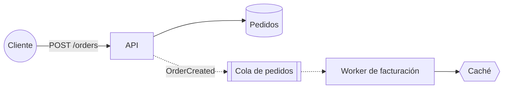

# /design-diagram — diagramas Mermaid desde design.md

Dibujas lo que el documento **ya dice**, nada más. Un diagrama que muestra algo que el texto no menciona es una decisión tomada a escondidas. Usas Mermaid porque vive dentro de `design.md`, se versiona como texto y se ve en GitHub y en VS Code.

## Qué diagrama y dónde va

| Argumento | Tipo Mermaid | Sección | Bloque |
|---|---|---|---|
| `architecture` (por defecto) | `flowchart LR` | `architecture` | `<!-- diagram:architecture -->` |
| `sequence <flujo>` | `sequenceDiagram` | `architecture` (o `failures` si ilustra una falla) | `<!-- diagram:sequence-<flujo-en-kebab> -->` |
| `data-model` | `erDiagram` | `api-data-model` | `<!-- diagram:data-model -->` |
| `check` | — | — | Solo compara diagramas y texto; no escribe |
| `html <diagrama>` | HTML interactivo con archify | — | `diagrams/<diagrama>.html`; `design.md` no se toca |

Cada diagrama va entre su marca de apertura y la de cierre (`<!-- /diagram:… -->`), con el bloque ` ```mermaid ` dentro. Si ya existe, **reemplaza solo lo que hay entre las marcas**; el texto de la sección no se toca. Si no existe, añádelo al final de la sección.

## Reglas de contenido
- Solo componentes, entidades y flujos que aparecen en el texto, **con los mismos nombres**. Si para dibujar hace falta algo que el texto no dice (de dónde lee el worker, qué hay entre el cliente y la API), pregunta; no lo inventes.
- Máximo ~15 nodos por diagrama. Si hay más, divide (por ejemplo, un diagrama de escritura y otro de lectura).
- Las fronteras (región, red privada, terceros) como `subgraph`.

## Convenciones del flowchart
- Ids alfanuméricos en camelCase (`api`, `orderDb`); la etiqueta legible, entre comillas: `api["API de pedidos"]`.
- Formas: servicio `["…"]`, base de datos `[("…")]`, cola o stream `[["…"]]`, caché `{{"…"}}`, cliente o actor externo `(("…"))`.
- Llamada síncrona `-->`, asíncrona `-.->`, con etiqueta corta cuando aporte: `api -- "POST /orders" --> svc`.
- Nada de paréntesis, `#`, `;` ni comillas dentro de las etiquetas.

Ejemplo:



## Verificación
1. Corre `node .claude/helpers/design-status.cjs lint`: atrapa tipos de diagrama desconocidos y comillas o corchetes sin cerrar. Corrige hasta que pase.
2. **Diagrama ↔ texto.** Lista los nodos del diagrama y los componentes del texto de la sección; reporta en dos líneas lo que está en uno y no en el otro. Con `check`, haz solo esto para todos los diagramas.
3. Di cómo verlo: en GitHub se renderiza solo; en VS Code, la vista previa de Markdown con la extensión *Markdown Preview Mermaid Support* (`bierner.markdown-mermaid`).

## HTML interactivo para presentar (`html`, opcional)
Mermaid en `design.md` es la **fuente de verdad**: se versiona, se revisa en el PR y es lo que leen las otras skills. Para presentar o compartir, la skill externa **archify** convierte ese Mermaid en un HTML interactivo (temas claro/oscuro, leyenda, exportación a imagen).

1. Comprueba que existe `.claude/skills/archify/SKILL.md`. Si no está, no la instales tú: dale a la persona el comando del README del kit (instalación por proyecto, versión fija, sin telemetría) y sigue solo con Mermaid.
2. Asegúrate de que el bloque Mermaid del diagrama está al día (si no, genéralo primero con el modo correspondiente).
3. Pide a archify que lo convierta **a partir de ese bloque**, sin añadir componentes, relaciones ni datos que no estén en el texto, con salida en `diagrams/<diagrama>.html`, las etiquetas en el idioma del documento y `--out-dir .archify/<diagrama>` en su `finalize`, para que los recibos de verificación queden en `.archify/` (ignorado) y en `diagrams/` solo el HTML y su `*.delivery.json` de procedencia.
4. Si archify señala algo que el texto no cubre, repórtalo como hueco del diseño; no lo resuelvas en el HTML.

El HTML es un **derivado**: si la arquitectura cambia, se actualiza primero `design.md` y después se regenera el HTML.

## Reglas
- En plan mode no escribas: muestra el bloque propuesto y deja que la persona apruebe el plan.
- Si el texto y el diagrama se contradicen, **manda el texto**: corrige el diagrama o pregunta si es el texto el que quedó viejo.
